# CareerForge AI

> **Build Smarter. Apply Stronger. Grow Further.**

CareerForge AI is a full-stack, AI-powered career and job application platform designed to connect the complete job-search workflow in one system.

Users can build their resume profile, explore published opportunities, analyze resume-to-job compatibility with AI, generate tailored cover letters, apply for positions, track application progress, and practice job-specific interviews with an AI Interview Coach.

The platform also includes an owner workflow for publishing job opportunities and managing candidate application stages.

---

## Screenshots

### Career Dashboard

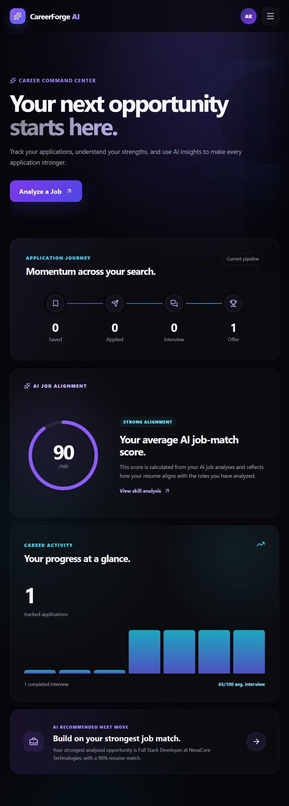

### Job Opportunities

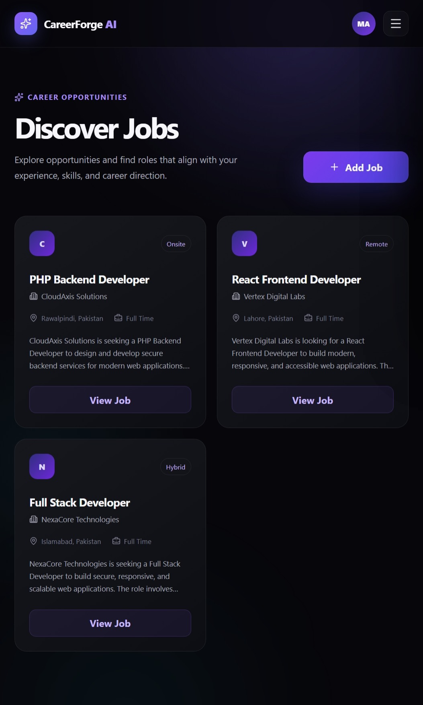

### Job Details

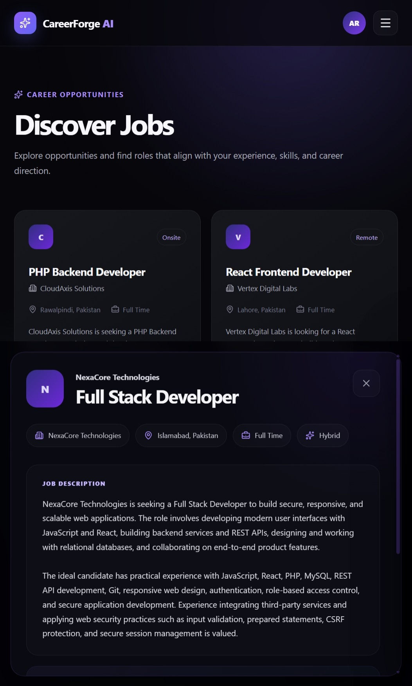

### Owner Job Publishing

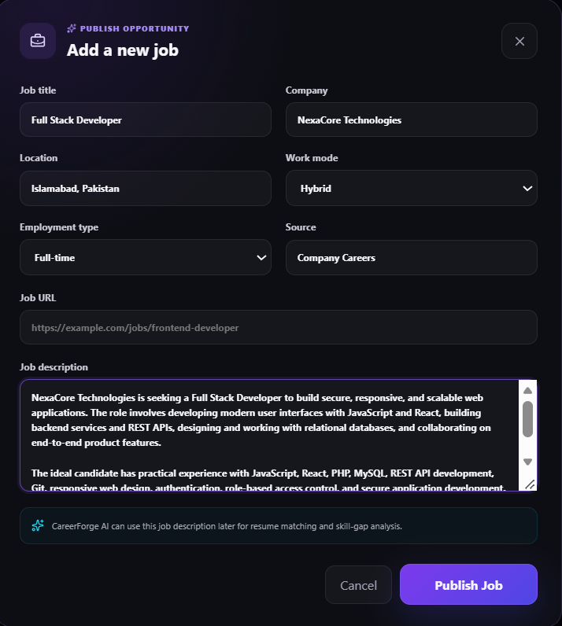

### AI Job Match

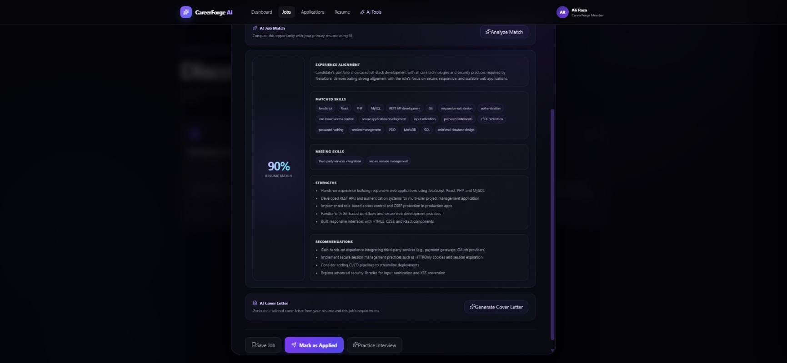

### AI Cover Letter Generator

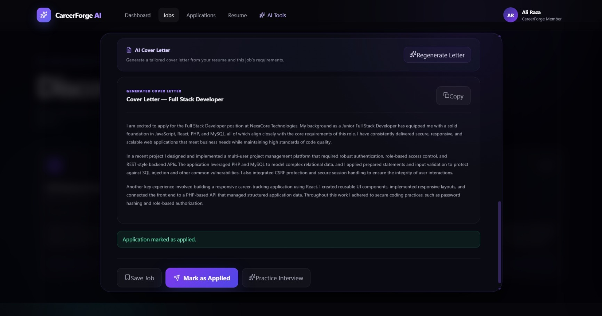

### Resume Workspace

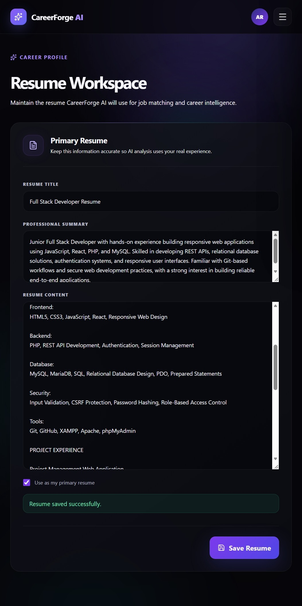

### Application Pipeline

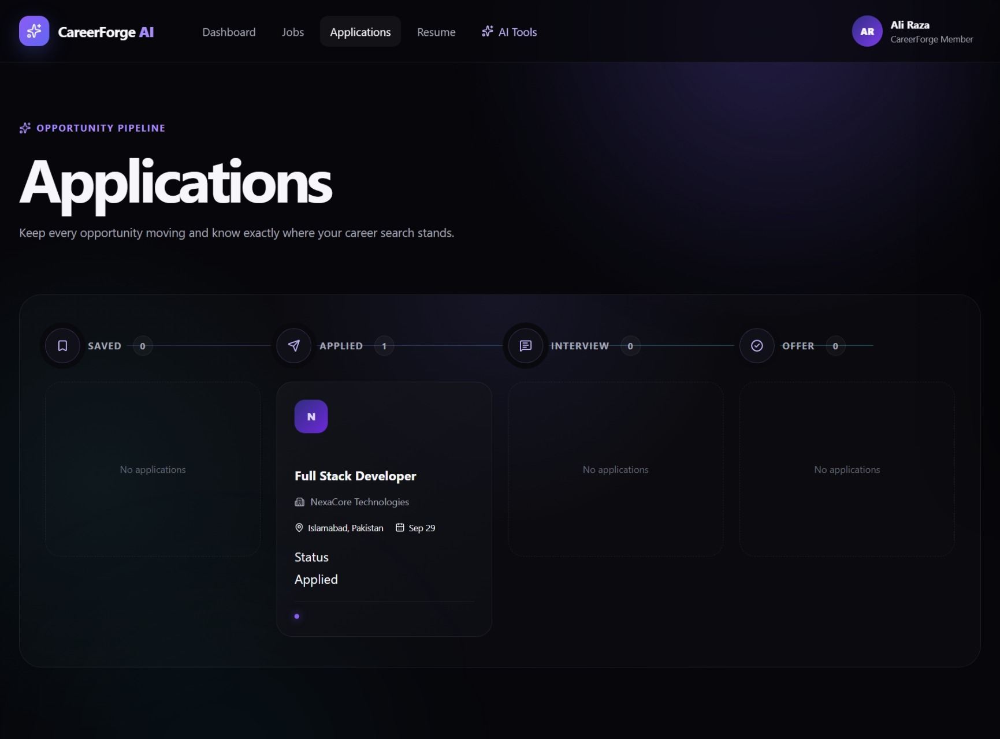

### AI Interview Coach

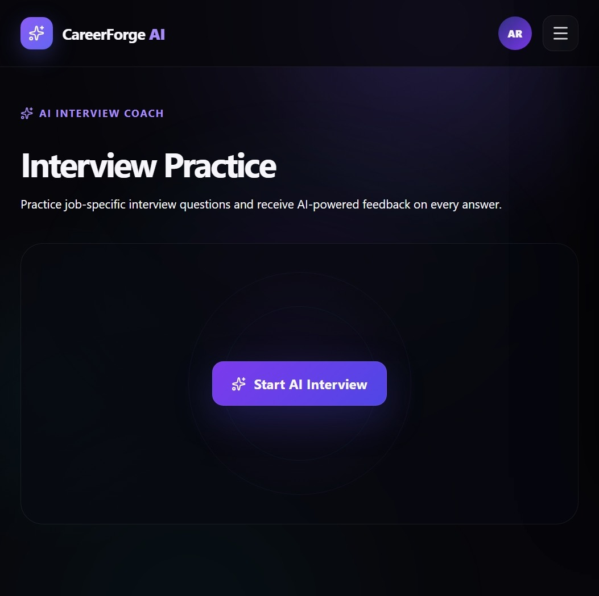

### Interview Question & Evaluation

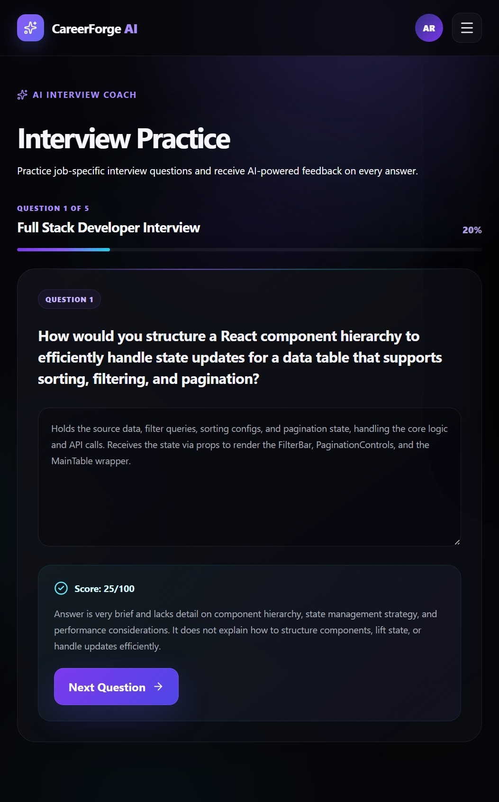

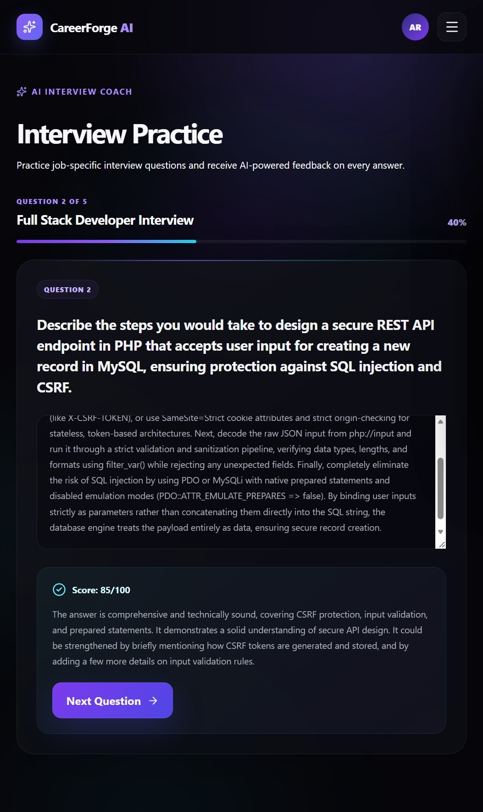

### Interview Performance

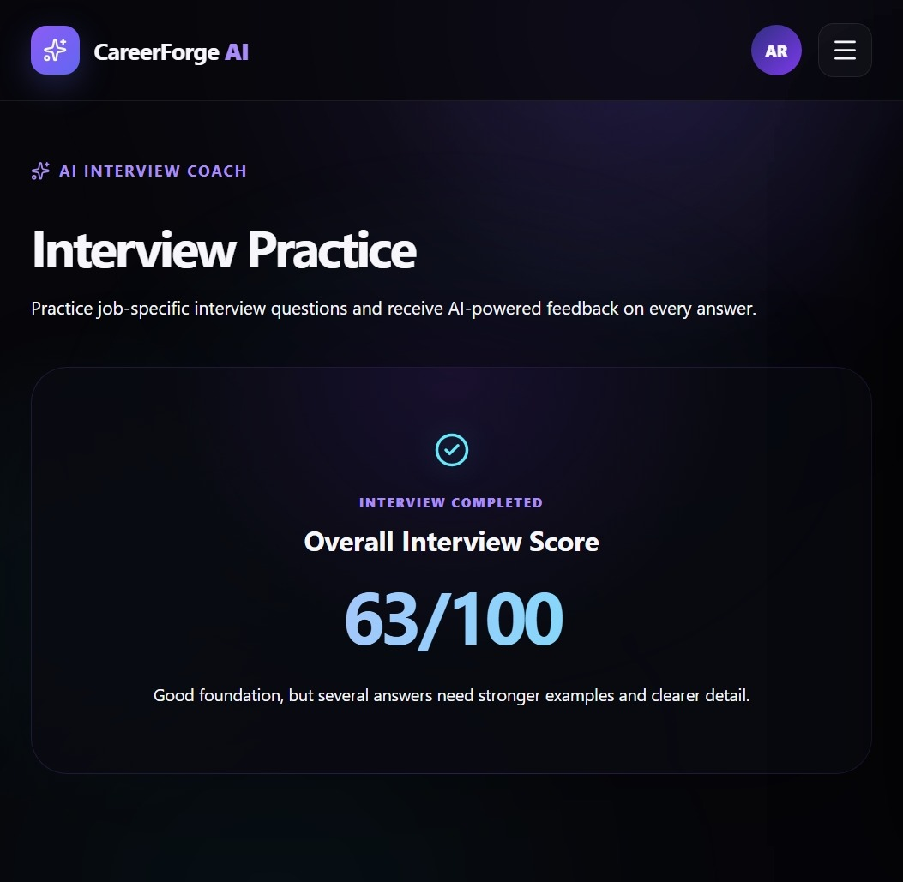

### Authentication

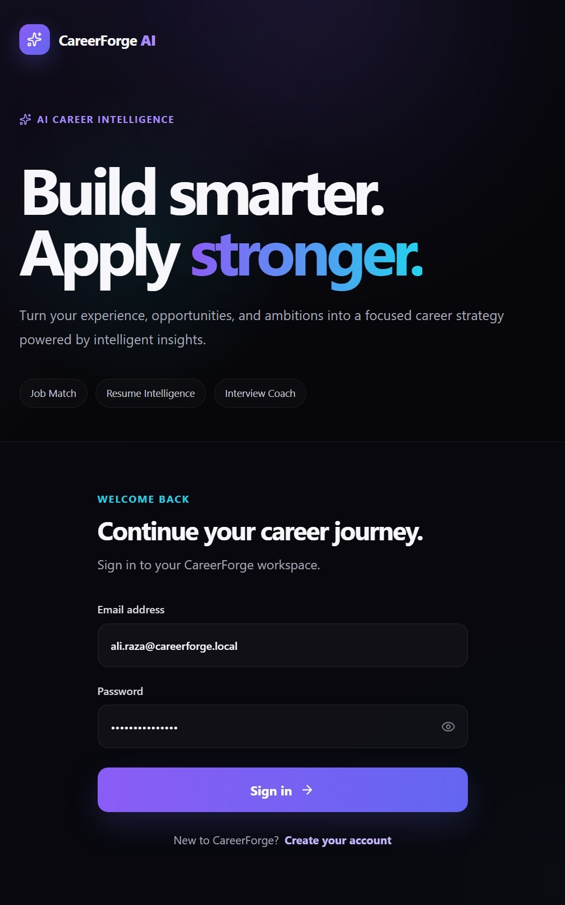

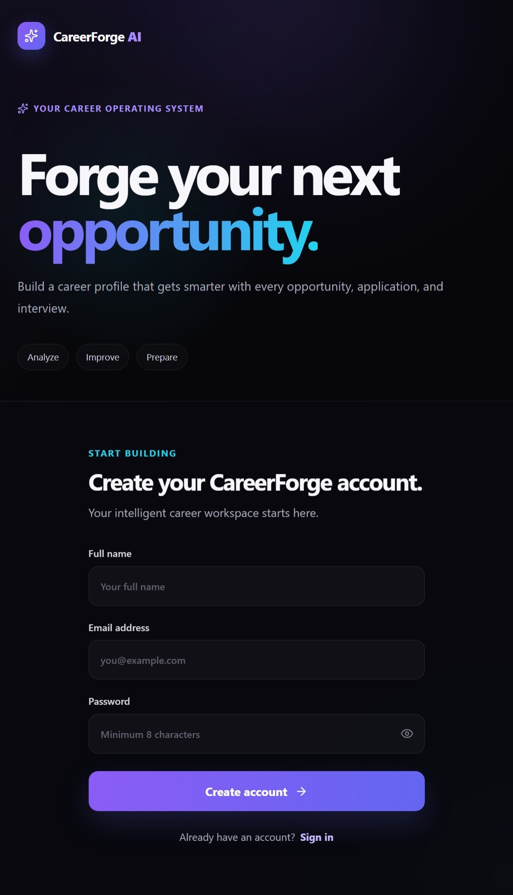


---

## Core Idea

CareerForge AI is built around two roles:

### Platform Owner

The owner manages the opportunity side of the platform.

The owner can:

- Publish job opportunities
- Define job requirements and descriptions
- View applications submitted by users
- Review applicant information
- Move applications through recruitment stages
- Mark applications as Applied, Interview, Offer, or Rejected

### Career User

Registered users manage their own career journey.

Users can:

- Create and maintain a resume
- Set a primary resume
- Browse published jobs
- View detailed job requirements
- Save or apply for opportunities
- Run AI-powered resume/job matching
- Identify matched and missing skills
- Receive AI recommendations
- Generate tailored cover letters
- Track application status
- Practice job-specific interviews with AI

---

## How the System Works

```text
Platform Owner
      │
      ▼
Publishes Jobs
      │
      ▼
Users Browse Opportunities
      │
      ▼
Resume Workspace
      │
      ▼
AI Job Match
      │
      ├── Match Score
      ├── Matched Skills
      ├── Missing Skills
      ├── Strengths
      └── Recommendations
      │
      ▼
Save / Apply
      │
      ▼
Application Pipeline
      │
      ▼
Owner Updates Application Stage
      │
      ▼
AI Interview Preparation
```

This separation keeps job publishing under platform ownership while users focus on their own resumes, applications, AI analysis, and interview preparation.

---

## AI Features

CareerForge integrates real generative AI through the Groq API.

### AI Job Match

The system analyzes a selected job against the user's primary resume.

The analysis can produce:

- Resume-to-job match score
- Relevant strengths
- Matched skills
- Missing skills
- Experience alignment
- Improvement recommendations

AI analysis results are stored so they can remain associated with the user, resume, and job.

### AI Cover Letter Generator

Users can generate a job-specific cover letter based on their resume and the selected opportunity.

The AI is instructed to:

- Use only resume-supported experience and skills
- Tailor content to the selected job
- Avoid inventing employers or qualifications
- Avoid presenting portfolio projects as employment
- Produce concise professional cover-letter content

### AI Interview Coach

CareerForge provides an interactive interview workflow based on the selected job.

The system:

1. Creates job-specific interview questions
2. Presents questions individually
3. Accepts the candidate's answer
4. Evaluates the response with AI
5. Returns feedback and a score
6. Continues through the interview session
7. Calculates an overall result when completed

This turns CareerForge from a simple job tracker into an interactive career preparation platform.

---

## Resume Workspace

Each user maintains their own career information.

Resume records support:

- Resume title
- Professional summary
- Resume content
- Primary resume selection

The primary resume is used by AI features when evaluating job compatibility and generating application content.

---

## Application Pipeline

Applications move through a structured career pipeline:

```text
Saved → Applied → Interview → Offer
                         └──→ Rejected
```

Application permissions are role-aware.

**Career users** can view their own application progress.

**Platform owners** can view submitted applications across users and manage recruitment-stage status.

Backend authorization protects these operations rather than relying only on frontend controls.

---

## Dashboard

The dashboard provides a high-level view of the user's career activity.

It brings together application progress, career readiness information, opportunity activity, and shortcuts into the platform's main workflows.

---

## Security

CareerForge was built with backend security as a core requirement.

Implemented protections include:

- PHP session-based authentication
- Strict session handling
- Cookie-only sessions
- `HttpOnly` session cookies
- `SameSite=Lax`
- HTTPS-aware secure cookies
- CSRF protection for state-changing requests
- Role-based authorization
- Object-level access controls
- PDO prepared statements
- Disabled emulated prepares
- Password hashing
- Input validation
- Output escaping practices
- Security-related HTTP headers
- Protected local database configuration
- Environment-based AI API credentials

Sensitive credentials are intentionally excluded from the repository.

---

## Technology Stack

### Frontend

- React
- Vite
- JavaScript
- HTML5
- CSS3
- Motion
- Lucide React
- React Router

### Backend

- PHP 8
- REST-style API architecture
- PHP Sessions
- PDO

### Database

- MySQL / MariaDB
- Relational database design
- Foreign-key relationships

### AI

- Groq API
- `openai/gpt-oss-20b`

### Development Tools

- Git
- GitHub
- XAMPP
- Apache
- phpMyAdmin
- ESLint

---

## Architecture

```text
React Client
     │
     │ REST-style requests
     ▼
PHP API Layer
     │
     ├── Authentication
     ├── Authorization
     ├── Jobs
     ├── Applications
     ├── Resumes
     ├── Dashboard
     └── AI Workflows
     │
     ├──────────────► Groq API
     │
     ▼
MySQL / MariaDB
```

The frontend and backend are separated into dedicated layers while session authentication connects protected React workflows with PHP APIs.

---

## Project Structure

```text
careerforge-ai/
├── api/
│   ├── ai/
│   │   ├── cover-letter.php
│   │   └── job-match.php
│   ├── applications/
│   │   ├── create.php
│   │   ├── list.php
│   │   └── update-status.php
│   ├── auth/
│   │   ├── login.php
│   │   ├── logout.php
│   │   ├── me.php
│   │   └── register.php
│   ├── dashboard/
│   │   └── summary.php
│   ├── interviews/
│   │   ├── answer.php
│   │   ├── complete.php
│   │   ├── session.php
│   │   └── start.php
│   ├── jobs/
│   │   ├── create.php
│   │   └── list.php
│   └── resumes/
│       ├── list.php
│       └── save.php
│
├── config/
│   └── database.example.php
│
├── database/
│   └── schema.sql
│
├── includes/
│   ├── api.php
│   └── session.php
│
├── screenshots/
│
├── src/
│   ├── components/
│   ├── pages/
│   ├── services/
│   ├── styles/
│   ├── App.jsx
│   ├── index.css
│   └── main.jsx
│
├── .gitignore
├── package.json
├── vite.config.js
└── README.md
```

---

## Database Design

CareerForge uses a relational database containing entities for:

- Users
- Career profiles
- Skills
- User skills
- Resumes
- Jobs
- Applications
- AI job analyses
- Interview sessions
- Interview questions
- Cover letters
- Notifications
- AI usage logs

Foreign-key relationships connect users with their career data while keeping jobs, applications, AI analyses, and interview sessions structurally linked.

---

## Local Setup

### Requirements

Install:

- Node.js
- npm
- PHP 8+
- MySQL or MariaDB
- Apache/XAMPP

### 1. Clone the repository

```bash
git clone <repository-url>
cd careerforge-ai
```

### 2. Install frontend dependencies

```bash
npm install
```

### 3. Create the database

Create a database named:

```text
careerforge_ai
```

Import:

```text
database/schema.sql
```

### 4. Configure the database

Copy:

```text
config/database.example.php
```

to:

```text
config/database.php
```

Then configure your local database credentials.

`config/database.php` is ignored by Git and should never be committed.

### 5. Configure the AI API key

CareerForge reads the Groq API key from the server environment:

```text
GROQ_API_KEY
```

Do not place API keys directly inside source files or commit them to Git.

### 6. Configure Apache

Configure the local Apache host so the PHP backend is accessible to the Vite development proxy.

The included Vite configuration proxies `/api` requests to the PHP application during local development.

### 7. Start the frontend

```bash
npm run dev
```

---

## Quality Checks

Frontend linting:

```bash
npm run lint
```

PHP syntax validation can be performed across the backend before release.

The project was also checked for accidentally committed development credentials and API keys before repository initialization.

---

## Design Approach

CareerForge uses a custom responsive interface rather than a prebuilt dashboard template.

The interface includes:

- Responsive navigation
- Career-focused dashboard
- Opportunity cards
- Job detail experiences
- AI analysis surfaces
- Application pipeline visualization
- Resume workspace
- Interactive interview experience
- Account and mobile navigation drawers
- Motion-based transitions and interactions

The interface is designed to remain usable across desktop and mobile screen sizes.

---

## Project Purpose

CareerForge AI was created as a full-stack software engineering portfolio project demonstrating the integration of:

- Modern React frontend development
- Secure PHP backend development
- Relational database architecture
- REST-style API design
- Authentication and authorization
- Role-aware workflows
- Generative AI integration
- Responsive UI engineering
- Application security practices

It demonstrates how AI can be incorporated into a conventional full-stack application as part of real product workflows rather than as an isolated chatbot feature.

---

## Author

**Muhammad Awais Khalid**

Software Engineer | Full-Stack Developer

---

## License

This project is provided for portfolio and educational purposes.